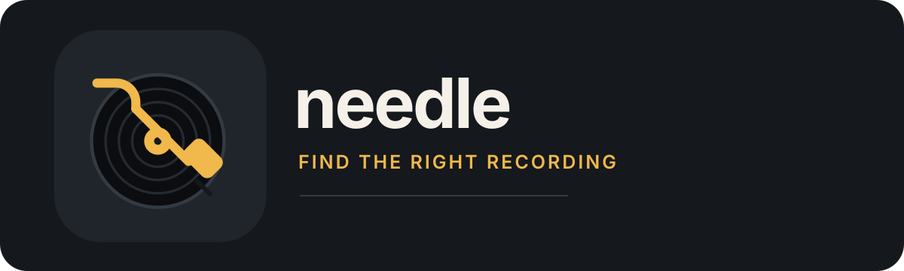

  

# needle

Needle helps you find the exact recording you want, review the available sources, and save a clean local music file. It is a strict recording resolver, not a generic downloader: wrongness stays visible.

## Download the Mac app

Download **[Needle 0.9.2](https://github.com/icebli/needle/releases/tag/v0.9.2)** for **Apple Silicon Macs (M1 or newer), macOS 15 Sequoia or later**. Open the `.dmg` and drag Needle to Applications. Follow [Getting started](docs/GETTING_STARTED.md) for your first recording and Spotify setup.

The app is unsigned. On first launch, macOS may require **System Settings → Privacy & Security → Open Anyway**. The installer includes its audio tools; you do not need Rust, Python, Xcode, or Homebrew.

## The friendly workflow

1. Enter an artist and title, or paste a supported source link.
2. Compare candidates using identity warnings, duration, artwork, source bitrate, play/view count, and uploader details.
3. Preview the exact candidate inside Needle before saving.
4. Save it to `~/Music/needle`. Needle tags the file, writes a provenance sidecar, and keeps the chosen source fixed.
5. Play it through Spotify Local Files, or optionally let the Needle companion add it to the named Spotify playlist after indexing.

Activity separates local saving from Spotify delivery and shows the confirmed playlist destination. Drop source links onto any tab to find candidates automatically in Review Queue. Review Queue also accepts multiple pasted links or artist/title lines, keeps each approval explicit, and downloads approved recordings in the background. Full-track previews support scrubbing and comparing candidates at the same timestamp. Library finds existing files, repairs artwork and tags, and can queue all eligible MP3s for Spotify. Discover syncs your top artists, checks popular source uploads against Spotify, and sends recordings to Review Queue for preview and approval. Advanced Settings and the full CLI remain available for direct URLs, alternate formats, duration overrides, and scripted workflows.

## Start here

| Goal | Guide |
| --- | --- |
| Install and save your first recording | [Getting started](docs/GETTING_STARTED.md) |
| Set up Spotify Local Files | [Getting started — Spotify](docs/GETTING_STARTED.md#listen-in-spotify) |
| Use advanced CLI commands | [CLI guide](docs/CLI.md) |
| Understand desktop controls | [Desktop guide](docs/desktop.md) |
| Install the Chrome / Firefox / Zen companion | [Browser companion](docs/browser-extension.md) |
| Read user-visible changes | [Changelog](CHANGELOG.md) |

## Quick start

1. Download the latest [Needle release](https://github.com/icebli/needle/releases) and move Needle to **Applications**.
2. Open Needle, approve **Open Anyway** in **System Settings → Privacy & Security** if macOS asks, then search for a recording.
3. Preview a candidate, choose **Save recording**, and wait for the file to appear in `~/Music/needle`.
4. In Spotify desktop, enable **Local Files** and add `~/Music/needle` as a source. Spotify can play these files without any extra integration.

For automatic playlist delivery, install [Spicetify](https://spicetify.app/) using its [official installation guide](https://spicetify.app/docs/advanced-usage/installation/), then follow the [Spotify companion setup](docs/GETTING_STARTED.md#optional-automatic-playlist-delivery). Spicetify is an optional Spotify customization tool; Needle does not need it for ordinary Local Files playback.

To capture tracks from Chrome, Firefox, or Zen, download `needle-companion.zip` from the latest release and follow the [browser companion setup](docs/browser-extension.md). The companion bundle includes its own installer and does not require Rust or a source checkout.

## Spotify

Spotify's desktop Local Files feature works without Spicetify. Enable Local Files, add `~/Music/needle` as a source, and let Spotify index each saved recording. Optional automatic playlist delivery requires Spotify, [Spicetify](https://spicetify.app/), and the Needle companion; [Spicetify alone is not enough](docs/GETTING_STARTED.md#optional-automatic-playlist-delivery).

Needle captures the playlist name when you search and reports delivery separately from saving. A waiting status means Spotify is still indexing or the companion has not acknowledged the file; retry delivery from Activity instead of downloading again.

## Updates

When Needle asks, choose **Check Automatically** and enable **Automatically download and install updates** if you want automatic updates. You can also choose **Needle → Check for Updates…** when available. If it is unavailable, download a newer version from the official releases page and replace the app in Applications. Your saved music stays in `~/Music/needle`. Unsigned versions may require **Open Anyway** again.

## License

Needle is released under the [MIT License](LICENSE). Bundled tools retain their own licenses and notices.
